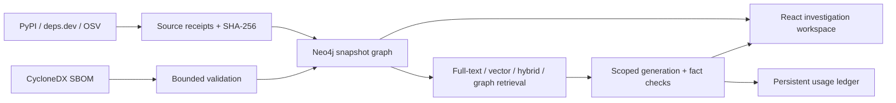

# DepScope

**Trace Python dependencies, investigate advisory matches, and compare snapshots with source-linked AI answers.**

DepScope is a local investigation workspace for Python AI applications. Import a software bill of materials (SBOM), follow indirect dependency paths in Neo4j, and inspect the original records behind a finding or generated answer.

**Python · FastAPI · Neo4j · React · TypeScript · Docker**

[中文](README.zh-CN.md) · [Quick start](#quick-start) · [Architecture](#architecture) · [Evaluation](docs/evaluation/results.md) · [Contributing](CONTRIBUTING.md) · [MIT License](LICENSE)


## What you can do

| Workflow | Implementation |
| --- | --- |
| Explore dependencies | Import CycloneDX 1.6 JSON or exact PyPI public resolutions; navigate snapshot-scoped graphs, shortest paths, and reverse impact. |
| Investigate advisories | Query OSV, merge advisory aliases, and inspect source records, query dates, coverage, and unknown states. |
| Compare snapshots | Compare component and advisory changes within a shared collection, with separate metadata, resolution, and test evidence levels. |
| Ask with evidence | Select a snapshot and advisory run; retrieve records using full-text, vector, hybrid, or hybrid + graph retrieval. |
| Inspect AI output | Check structured facts and citation locations against supplied evidence; retain insufficient-evidence and withheld-output states. |
| Control API usage | Persist call reservations, token usage, estimated costs, and explicit spending limits across restarts. |

## Quick start

**Requirements:** Git, Docker, and Docker Compose v2. Run from the repository root:

```sh
cp .env.example .env
# Edit .env and set NEO4J_PASSWORD. A model API key is optional.
export DEPSCOPE_LOCAL_UID=$(id -u)
docker compose build
docker compose up -d --wait
```

| Service | Address |
| --- | --- |
| Workspace | http://127.0.0.1:8080 |
| API documentation | http://127.0.0.1:8101/docs |
| Neo4j browser | http://127.0.0.1:17474 |

Click **Load verified public sample** to explore the archived LangChain dependency graph. You can also create a project and upload a CycloneDX 1.6 JSON file. Graph exploration and snapshot comparison work without a generation API key.

AI investigation additionally requires a configured generation provider, initialized embeddings, and explicit call/cost limits. Startup does not make paid calls or download a model. See [setup and native development](docs/operations/setup.md) for configuration and troubleshooting.

The default deployment binds ports to loopback. Keep `.env`, `data/runtime/`, and `artifacts/private/` private. See [security](SECURITY.md) before changing the deployment model.

## Architecture



- **Snapshot isolation:** component instances remain distinct from package versions; graph queries retain their project and snapshot context.
- **Traceable evidence:** original source bytes, hashes, dates, and field locations connect findings to the records used to produce them.
- **Durable operations:** a single mutation queue supports bounded background jobs, retries, and recovery. Database and evidence storage persist across restarts.
- **Controlled generation:** retrieval, provider calls, output validation, and budget accounting have separate boundaries and explicit failure states.

```text
backend/       FastAPI, graph storage, ingestion, investigation, and tests
frontend/      React + TypeScript workspace and browser tests
migrations/    Neo4j schema setup
schemas/       CycloneDX validation schemas
artifacts/     Frozen corpus, benchmark, experiment results, and demo evidence
docs/          Setup, architecture, evaluation, and operations
scripts/       Verification and release evidence tools
```

The committed evidence makes the evaluation inspectable from a fresh clone. Runtime data, credentials, local environments, and private backups are excluded from version control.

## Evaluation

The frozen corpus contains **15 roots, 45 complete public-resolution snapshots, 10 root families, and 30 comparisons**. Two repository-owned applications also have recorded installed-environment SBOMs.

The recorded experiment evaluated **four retrieval methods over 200 questions**: 60 development and 140 test questions, with 800 generation calls across both splits. Reference labels were generated from raw source records and independent NetworkX traversal.

| Method | Exact facts on 126 non-missing test questions | Evidence Recall@10 |
| --- | ---: | ---: |
| Full-text | 24.6% (31/126) | 36.9% |
| Vector | 37.3% (47/126) | 57.7% |
| Hybrid | 39.7% (50/126) | 62.6% |
| Hybrid + graph | 38.1% (48/126) | 54.6% |

Hybrid exceeded full-text by **15.1 percentage points on this test set**. Graph expansion did not improve on hybrid under the fixed context budget. The [evaluation report](docs/evaluation/results.md) includes failures, the 14 missing-evidence questions, latency, cost estimates, and limitations.

These are results for the frozen corpus and configuration. Public resolutions do not reconstruct historical installed environments; program labels are not human gold labels. The test set covers seven underlying families. Citation location checks do not establish semantic support or exploitability.

## Development and checks

Use **Python 3.11** and **Node 22.23.3** (`.nvmrc`). After following [native setup](docs/operations/setup.md#native-development), run:

```sh
# Backend unit tests: no database or model service required.
backend/.venv/bin/python -m pytest backend/tests/unit -q

# Start the dedicated test database, then run integration tests.
docker compose -f compose.yaml -f compose.test.yaml --profile test up -d --wait neo4j-test
backend/.venv/bin/python -m pytest backend/tests/integration -q

# Frontend tests and production build.
cd frontend
npm test -- --run
npm run build
```

[GitHub Actions](.github/workflows/ci.yml) runs backend unit and real Neo4j integration tests, frontend tests, and the production build. HTTP/model boundaries use test fixtures; normal checks do not run the paid benchmark. Browser and signed release checks are documented in [verification](docs/operations/verification.md).

## Documentation

- [Installation and troubleshooting](docs/operations/setup.md)
- [Source dictionary and evidence model](docs/architecture/source_dictionary.md)
- [Evaluation protocol](docs/evaluation/protocol.md) and [recorded results](docs/evaluation/results.md)
- [Five-minute demo](docs/portfolio/demo_script.md)
- [Verification](docs/operations/verification.md) and [backup/restore](docs/operations/backup.md)
- [Contributing](CONTRIBUTING.md) and [security](SECURITY.md)

## License

Project-authored code and documentation are available under the [MIT License](LICENSE). Third-party dependencies, vendored schemas, and archived upstream records retain their respective licenses and notices.
