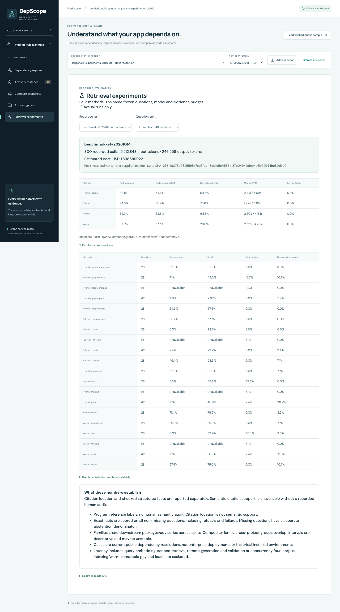
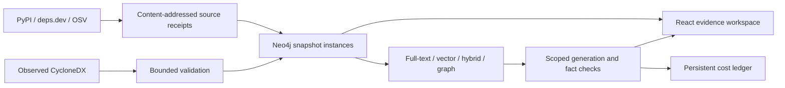

# DepScope

Evidence-grounded dependency investigation for Python AI applications, built with **Neo4j, FastAPI, React and a configurable generation API**.

Explore an exact dependency snapshot, inspect known OSV advisory matches and indirect paths, compare candidate snapshots, and ask a scoped question with locatable sources. Unknown query/dependency states remain visible. Generated explanations are unverified; precise facts are checked against supplied receipts. Nothing automatically changes dependencies.

[中文说明](README.zh-CN.md) · [Setup](docs/operations/setup.md) · [Actual evaluation](docs/evaluation/results.md) · [Source dictionary](docs/architecture/source_dictionary.md) · [Demo](docs/portfolio/demo_script.md)



## Run locally

```sh
cp .env.example .env
# Set your private Neo4j password; the model API key is optional for core features.
export DEPSCOPE_LOCAL_UID=$(id -u)
docker compose build
docker compose up -d --wait
```

UI: **http://127.0.0.1:8080** · API docs: http://127.0.0.1:8101/docs · Neo4j: http://127.0.0.1:17474

All published ports bind loopback. Keep `.env`, `data/runtime` and `artifacts/private` private. Database/log volumes, raw evidence, verification records and cost ledger persist across restarts. Startup does not call paid generation or automatically download a model. See [setup](docs/operations/setup.md) for native development, internal Ollama and explicit model initialization.

## What is implemented

- Strict CycloneDX 1.6 import, exact PyPI public-resolution import, duplicate-file idempotency, immutable snapshot context and a durable single mutation queue.
- Separate component instances/package versions; scoped bounded graph views, deterministic shortest paths and reverse impact.
- OSV batching/pagination, withdrawn/alias handling, immutable query runs and explicit coverage/unknown states.
- Same-collection snapshot comparisons; metadata, resolution and test evidence levels with locally signed controlled verification.
- Four retrieval methods, versioned full-text/vector indexes, bounded evidence context, structured-fact/citation validation and explicit cross-project selection.
- Persisted generation reservations, usage/cost estimates and explicit limits that do not reset spending on restart.
- Actual experiment browser, locked container setup, real Neo4j integration tests, private offline backup and new-instance restore tooling.



## Actual evidence, not projected outcomes

The frozen public corpus contains **15 roots, 45 complete current public resolutions, 10 root families and 30 comparisons**. Separately, two repository-owned applications have actual installed-environment SBOMs and recorded installation/tests. Public cases are not enterprise deployments, and older root versions do not reconstruct historical installations.

The principal evaluation uses **200 questions, 60 development / 140 test, four methods and 800 real generation calls**. Program reference labels come from raw source records and independent NetworkX traversal, not human gold labels or product path code.

| Frozen test method | Exact facts, 126 non-missing questions | Evidence Recall@10 |
| --- | ---: | ---: |
| Full-text | 24.6% (31/126) | 36.9% |
| Vector | 37.3% (47/126) | 57.7% |
| Hybrid | 39.7% (50/126) | 62.6% |
| Hybrid + graph | 38.1% (48/126) | 54.6% |

Graph expansion did **not** improve on hybrid in this configuration. All failures/refusals are retained. The run recorded 5,212,843 input / 246,258 output tokens and **USD 1.638689922 peak-rate upper-bound estimate**, not an invoice. See the [report and denominators](docs/evaluation/results.md). Seven test families and overlapping composite bootstrap groups limit inference. Citation location does not establish semantic support; no human semantic audit or user/business-impact study is claimed.

## Verification and private data

See [verification](docs/operations/verification.md), [backup/restore](docs/operations/backup.md), and the generated `artifacts/verification/release-manifest.json`. Missing acceptance evidence is not treated as a pass. Ordinary CI uses offline external-service fixtures plus real Neo4j and never secretly runs paid evaluations. A live browser generation check requires explicit opt-in.

This is a **local repository**. No GitHub publication, deployed customer system, user count, ROI or proven security-impact reduction is claimed. [Resume evidence](docs/portfolio/resume_evidence.md) links every usable number to actual artifacts.
