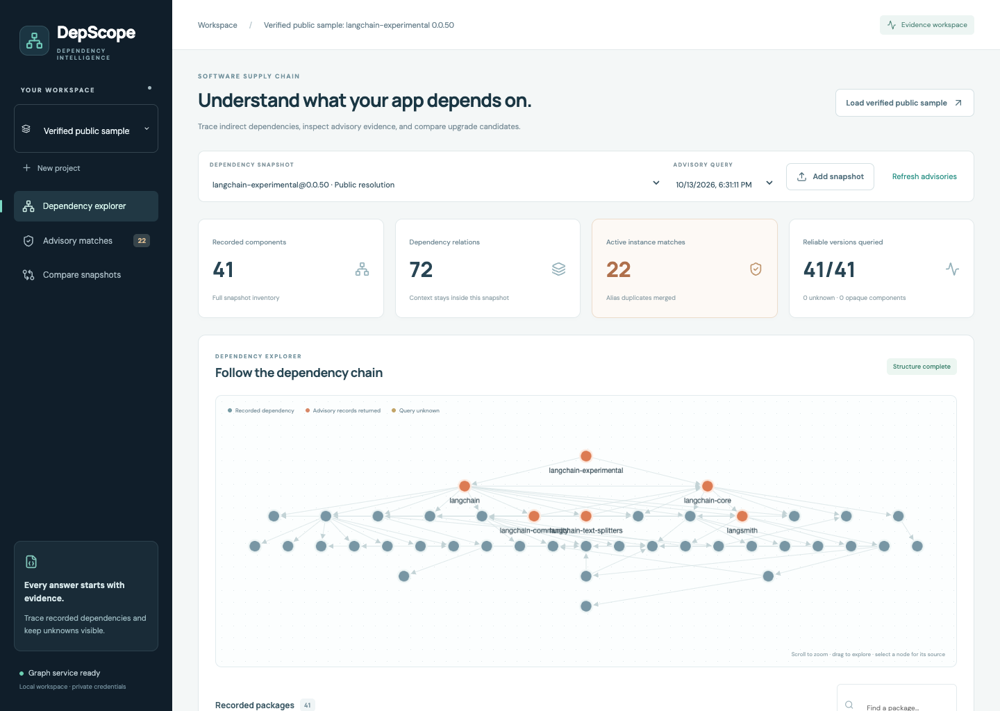

# DepScope

**追踪 Python 依赖、调查安全公告、比较版本快照，让 AI 回答关联到原始证据。**

DepScope 是面向 Python AI 应用的本地依赖调查工作台。导入软件物料清单（Software Bill of Materials，SBOM），在 Neo4j 中追踪间接依赖，并查看每条发现和生成回答使用的原始资料。

**Python · FastAPI · Neo4j · React · TypeScript · Docker**

[English](README.md) · [安装说明](docs/operations/setup.md) · [实验结果](docs/evaluation/results.md) · [贡献指南](CONTRIBUTING.md)



## 主要功能

| 场景 | 已实现能力 |
| --- | --- |
| 探索依赖 | 导入 CycloneDX 1.6 JSON 或指定 PyPI 版本的公开解析结果，查看快照内依赖图、最短路径及反向影响。 |
| 调查公告 | 查询 OSV、合并公告别名，保留原始记录、查询时间、覆盖率及未知状态。 |
| 比较快照 | 在同一公告资料集合中比较组件及匹配变化，区分元数据、依赖解析和实际测试证据。 |
| 证据问答 | 明确选择快照和公告查询，使用全文、向量、混合或混合加图扩展检索。 |
| 检查输出 | 核对结构化事实和引用位置，明确呈现证据不足及被拦截的输出。 |
| 管理费用 | 持久化调用预留、token 使用量、费用估算和预算限制，重启后继续累计。 |

## 快速启动

需要 Git、Docker 和 Docker Compose v2。在仓库根目录运行：

```sh
cp .env.example .env
# 编辑 .env，设置自己的 NEO4J_PASSWORD；模型 API key 为可选项。
export DEPSCOPE_LOCAL_UID=$(id -u)
docker compose build
docker compose up -d --wait
```

| 服务 | 地址 |
| --- | --- |
| 工作台 | http://127.0.0.1:8080 |
| API 文档 | http://127.0.0.1:8101/docs |
| Neo4j 浏览器 | http://127.0.0.1:17474 |

点击 **Load verified public sample**，即可探索已归档的 LangChain 依赖图；也可以创建项目并上传 CycloneDX 1.6 JSON。依赖图和快照比较不需要生成模型的 API key。

AI 问答还需要配置生成服务、初始化向量模型并设置调用与费用上限。启动时不会调用付费模型或自动下载模型。完整配置、原生开发和常见问题见[安装说明](docs/operations/setup.md)。

默认端口仅绑定本机。`.env`、`data/runtime/` 和 `artifacts/private/` 保留在本地；改变部署方式前请阅读[安全说明](SECURITY.md)。

## 工程设计

- **快照隔离：** 区分组件实例与包版本，图查询保留所属项目、快照和时间上下文。
- **来源追溯：** 保存原始字节、SHA-256、采集日期及字段位置，使结果能回查到所用资料。
- **持久化任务：** 使用单一变更队列处理后台任务、重试和恢复，图数据及证据文件跨重启保留。
- **生成边界：** 分离检索、模型调用、输出校验和预算管理，失败与证据不足都有明确状态。

架构图和目录结构见 [English README](README.md#architecture)。仓库包含冻结语料、基准题集和实验结果，方便从新克隆的仓库检查实验依据。

## 实验结果

冻结语料包含 **15 个根包、45 份完整公开解析快照、10 个包家族及 30 组比较**；另有两个仓库自有应用的实际安装环境 SBOM。

四种检索策略在 **200 道题**上进行了 800 次生成调用，开发集 60 题、测试集 140 题。参考标签来自原始资料和独立 NetworkX 遍历。

| 检索策略 | 测试集 126 道非缺失事实题的准确率 | Evidence Recall@10 |
| --- | ---: | ---: |
| 全文 | 24.6%（31/126） | 36.9% |
| 向量 | 37.3%（47/126） | 57.7% |
| 混合 | 39.7%（50/126） | 62.6% |
| 混合 + 图扩展 | 38.1%（48/126） | 54.6% |

本测试集上，混合检索比全文高 **15.1 个百分点**；固定上下文预算下，图扩展没有超过混合方案。[完整报告](docs/evaluation/results.md)保留了失败结果、14 道证据缺失题、耗时、费用估算及统计局限。

结果仅适用于这份语料和配置。公开解析不等于历史安装环境，程序标签不等于人工金标准；测试集覆盖七个底层家族。引用位置校验不能证明语义支持，公告匹配也不能直接证明漏洞可利用。

## 开发与验证

原生开发使用 Python 3.11 和 Node 22.23.3（`.nvmrc`）。[贡献指南](CONTRIBUTING.md)提供后端单元测试、独立 Neo4j 集成测试、前端测试和构建命令。

[GitHub Actions](.github/workflows/ci.yml)配置了上述检查。普通测试在外部 HTTP 和模型边界使用测试数据；浏览器流程、付费评估和签名验收的运行方式见[验证说明](docs/operations/verification.md)。

更多资料：[来源字典](docs/architecture/source_dictionary.md) · [评估协议](docs/evaluation/protocol.md) · [五分钟演示](docs/portfolio/demo_script.md) · [备份恢复](docs/operations/backup.md)

## 许可证

项目自有代码和文档采用 [MIT 许可证](LICENSE)。第三方依赖、内置规范及归档的上游资料保留各自的许可与声明。
